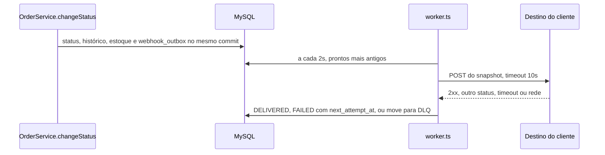

# FDD: Sistema de Webhooks de Notificação de Pedidos

Especificação para implementar a feature. Decisões fechadas: [ADRs](adrs/README.md). Por que a feature existe: [PRD](PRD.md). Proposta e o que ainda está em aberto: [RFC](RFC.md).

## Contexto e motivação técnica

`OrderService.changeStatus` (`src/modules/orders/order.service.ts`) abre `prisma.$transaction`, valida a transição com `canTransition`, debita ou devolve estoque, atualiza `orders.status` e insere `order_status_history`. Não há POST, fila nem tabela de evento em lugar nenhum do repositório.

Colocar HTTP dentro dessa callback alonga o lock da transação pelo tempo do cliente e transforma falha de rede em rollback de status. A feature grava o fato na mesma transação e tira a rede para um processo que só existe para drenar a tabela.

O model `User` não tem `customerId`. O JWT (`src/middlewares/auth.middleware.ts`) carrega `id`, `email` e `role` (`ADMIN` | `OPERATOR`). O customer do webhook viaja no corpo, no mesmo espírito de `createOrderSchema`.

## Objetivos técnicos

- Nenhuma transição commitada por `changeStatus` com endpoint ativo inscrito fica sem linha de outbox, e nenhuma linha de outbox sobrevive a rollback.
- O processo da API não executa o POST ao cliente.
- O contrato externo é estável: snapshot, HMAC-SHA256, `X-Event-Id` imutável, timeout de 10 segundos, retentativas na progressão fechada.
- Erros do módulo saem no envelope que `errorMiddleware` já produz, com código `WEBHOOK_*` quando o caso é do módulo.

## Escopo e exclusões

Entra: módulo novo `src/modules/webhooks/`, models Prisma novos, alteração cirúrgica de `changeStatus` para chamar `publishWebhookEvent`, entrypoint novo `src/worker.ts`, script npm, rotas sob `/api/v1`.

Esses caminhos ainda não existem no repositório. Foram nomeados na reunião e são o que a implementação cria. Qualquer outro caminho de código citado neste FDD já está no OMS hoje.

Não entra, e a implementação não deve preparar “gancho” para isso:

- e-mail de falha;
- tela;
- rate limit de saída;
- job de arquivar linha entregue após 30 dias;
- webhook inbound;
- segundo worker, partição por `order_id` ou lock pessimista;
- exactly-once;
- itens do pedido no JSON;
- evento na `OrderService.create`. Esse método grava `PENDING` e a primeira linha de histórico sozinho. A reunião apontou o gancho em `changeStatus`.

Valores que a reunião não numerou e este FDD fixa para o código ter uma constante só, sem tratar o número como requisito de produto:

| Constante | Valor | Por quê está aqui |
| --- | --- | --- |
| `OUTBOX_BATCH_SIZE` | 10 | Diego pediu lote pequeno e não escolheu o tamanho. |
| Secret | `crypto.randomBytes(32)` em hex (64 caracteres) | Sofia pediu secret gerada por nós e vai revisar. O comprimento não foi dito. |
| Codificação de `X-Signature` | hex minúsculo do HMAC-SHA256 | O algoritmo e a entrada (corpo cru) foram decididos. A codificação, não. |
| Header da secret anterior | `X-Signature-Previous` | O grace de 24 horas foi decidido. O nome do segundo header, não. |

## Fluxos detalhados

### Modelo de dados

Novas tabelas no MySQL, ids `@id @default(uuid()) @db.Char(36)`, como `Order`.

`webhook_endpoints`

| Coluna | Papel |
| --- | --- |
| `id` | UUID do cadastro. Vai no header `X-Webhook-Id`. |
| `customer_id` | FK para `customers.id`. |
| `url` | Destino https. |
| `secret` | Secret vigente, recuperável. Nunca hash irreversível. |
| `previous_secret` | Secret anterior, nula se não houve rotação. |
| `previous_secret_expires_at` | Fim das 24 horas. Nula se não há secret anterior. |
| `event_types` | Lista de `OrderStatus` que o endpoint aceita. |
| `active` | Inativo não entra na inserção. |
| `created_at`, `updated_at` | Auditoria simples, no padrão dos outros models. |

Índice em `(customer_id, active)`.

`webhook_outbox`

| Coluna | Papel |
| --- | --- |
| `id` | UUID. É o `event_id` e o valor de `X-Event-Id`. |
| `webhook_endpoint_id` | Qual cadastro receberá o POST. Uma transição gera uma linha por endpoint inscrito, não uma linha fatiada depois. |
| `order_id` | Pedido. Base da regra de ordem. |
| `status` | `PENDING`, `PROCESSING`, `FAILED`, `DELIVERED`. São os quatro estados citados: pendente, processando, falhou, entregue. |
| `payload` | JSON snapshot. |
| `attempt_count` | Chamadas HTTP já concluídas. Começa em 0. |
| `next_attempt_at` | Nulo enquanto `PENDING` recém-criado. Preenchido em `FAILED`. |
| `last_error_code` | Último `WEBHOOK_DELIVERY_*` ou código de rede. |
| `processing_started_at` | Quando entrou em `PROCESSING`. |
| `created_at` | Ordem de inserção. É a ordem do pedido. |
| `delivered_at` | Preenchido em `DELIVERED`. |

Índices: `(status, created_at)` como pedido na reunião; `(order_id, created_at)` para a checagem de ordem; `(next_attempt_at)` para o que já venceu a espera.

`webhook_dead_letter` (nome pedido na reunião)

| Coluna | Papel |
| --- | --- |
| `id` | UUID usado em `/dead-letter/:id/replay`. |
| `event_id` | O mesmo UUID da outbox. |
| `webhook_endpoint_id`, `order_id` | Contexto. |
| `payload` | Cópia do snapshot. |
| `failure_reason` | Código e mensagem da última falha. |
| `attempt_count` | Quantas chamadas aconteceram. |
| `failed_at` | Timestamp da ida para a DLQ. |
| `replayed_at` | Nulo até o primeiro replay. A linha permanece como evidência. |

`webhook_deliveries`

Uma linha por tentativa HTTP, não por evento. É o que o histórico de “sucesso/falha, payload, response, tempo” precisa, inclusive nas retentativas.

| Coluna | Papel |
| --- | --- |
| `id` | UUID. |
| `webhook_endpoint_id`, `event_id` | Correlação. |
| `outcome` | `SUCCESS` ou `FAILURE`. |
| `payload` | Snapshot enviado. |
| `response_status` | HTTP do destino, nulo em timeout ou erro de rede. |
| `response_body` | Corpo devolvido, quando houve. |
| `duration_ms` | Tempo da tentativa. |
| `attempt_number` | 1 no envio inicial, sobe a cada chamada. |
| `created_at` | Ordem do histórico. |

### Criação do evento na outbox

`publishWebhookEvent(tx, order, fromStatus, toStatus)` usa o `Prisma.TransactionClient` que `changeStatus` já tem. Não abre outra transação.

1. Busca em `webhook_endpoints`, pelo `tx`, os registros com `customer_id = order.customerId`, `active = true` e `event_types` contendo `toStatus`.
2. Se a lista vier vazia, retorna sem escrever.
3. Para cada endpoint, monta o snapshot (ADR-007) e serializa com `JSON.stringify`. Se o byte length UTF-8 passar de 65536, lança `WEBHOOK_PAYLOAD_TOO_LARGE`. A exceção sobe da callback e o Prisma desfaz status, histórico, estoque e qualquer outbox irmã da mesma transição. Não truncar. Não enviar. Não engolir o erro: engolir criaria status commitado sem evento, que a reunião proibiu.
4. Insere uma linha `PENDING`, `attempt_count = 0`, `next_attempt_at = null`, `id` gerado, `payload` igual ao objeto serializado.

O snapshot, em snake_case, é só o que foi nomeado na reunião:

```json
{
  "event_id": "6f1c0c3e-7b1a-4e0d-9c2a-1a2b3c4d5e6f",
  "event_type": "order.status_changed",
  "timestamp": "2026-11-18T12:04:00.000Z",
  "order_id": "a1b2c3d4-e5f6-7890-abcd-ef1234567890",
  "order_number": "ORD-000123",
  "from_status": "PAID",
  "to_status": "PROCESSING",
  "customer_id": "0f1e2d3c-4b5a-6978-8877-665544332211",
  "total_cents": 15900
}
```

`timestamp` é o instante da inserção, ISO 8601 em UTC. `total_cents` e `order_number` vêm da linha de `orders` já carregada na transação. Não reler o pedido depois.

`changeStatus` chama a função depois do `orderStatusHistory.create` e antes do fim da callback, passando `from`, `to` e o pedido (precisa de `id`, `orderNumber`, `customerId`, `totalCents`). O `findUnique` inicial desse método hoje traz `items` e não traz `orderNumber` no sentido de que o `order` do `findUnique` inclui todos os escalares, então `orderNumber` e `totalCents` já estão na linha. Não é necessário um segundo select só para o snapshot.



### Processamento pelo worker

`src/worker.ts` sobe o processo, cria `PrismaClient` com `createPrismaClient()` e entra no loop. No `SIGINT`/`SIGTERM`, para o loop, espera a tentativa HTTP em curso respeitando o timeout, e chama `$disconnect`. Espelha o shutdown de `src/server.ts` sem o `listen` HTTP.

A cada 2 segundos:

1. **Recuperar órfão de processo morto.** Linha `PROCESSING` cujo `processing_started_at` é mais antigo que o timeout de entrega (10 segundos) volta para `FAILED`, com `next_attempt_at` no passado e sem incrementar `attempt_count`. A tentativa seguinte pode repetir um POST que o processo morto talvez já tenha feito. Isso é at-least-once. A reunião não desenhou um reaper; sem esta regra o estado “processando” prende o pedido para sempre depois de um kill. O limiar é o timeout já decidido, não um SLO novo.
2. **Ler o lote.** Até `OUTBOX_BATCH_SIZE` linhas com status `PENDING` ou `FAILED`, `next_attempt_at` nulo ou `<= now()`, ordenadas por `created_at` ascendente. Numa transação curta, marcá-las `PROCESSING` e preencher `processing_started_at`. Um worker só: não usar `SKIP LOCKED` nem prometer concorrência.
3. **Respeitar a ordem do pedido.** Antes de enviar a linha, se existir outra linha da outbox do mesmo `order_id` com `created_at` menor e status diferente de `DELIVERED`, não enviar. Deixar a mais nova como está e seguir para outro pedido do lote. Quando a mais antiga for para a DLQ, ela sai da outbox e a mais nova destrava. Haverá um buraco na sequência desse pedido. É o efeito de ter desistido do evento antigo.
4. **Enviar em sequência**, não em `Promise.all`, para o mesmo processo não inverter dois eventos.
5. **Sucesso** é resposta HTTP com status 200–299. Grava `webhook_deliveries` com `SUCCESS`, marca a outbox `DELIVERED` e preenche `delivered_at`.
6. **Falha** é timeout, erro de rede ou status fora de 2xx. Grava `webhook_deliveries` com `FAILURE` e segue a política de retry.

O POST usa `fetch` do Node 20 (o `package.json` exige `node >= 20`). Sem cliente HTTP novo. `AbortSignal.timeout(10_000)`. O corpo enviado é a string JSON já armazenada, byte a byte. O HMAC é dessa string, não de um objeto re-serializado com outra ordem de chaves.

### Retry

`BACKOFF_MS`, nesta ordem: 60_000, 300_000, 1_800_000, 7_200_000, 43_200_000.

Depois de uma chamada fracassada o worker incrementa `attempt_count`.

| `attempt_count` depois da falha | O que é | Próximo passo |
| --- | --- | --- |
| 1 | Falha do envio inicial | `FAILED`, espera 1 minuto |
| 2 | Falha da 1ª retentativa | `FAILED`, espera 5 minutos |
| 3 | Falha da 2ª retentativa | `FAILED`, espera 30 minutos |
| 4 | Falha da 3ª retentativa | `FAILED`, espera 2 horas |
| 5 | Falha da 4ª retentativa | `FAILED`, espera 12 horas |
| 6 | Falha da 5ª retentativa | Move para a DLQ. Não há outra espera. |

A soma 1m+5m+30m+2h+12h é 14 horas e 36 minutos entre a primeira falha e o início da última retentativa. É a conta que Diego chamou de quase 15 horas. O envio inicial não consome um degrau. A leitura está justificada no ADR-002; o implementador não escolhe outra tabela.

`next_attempt_at = now + BACKOFF_MS[attempt_count - 1]` para `attempt_count` de 1 a 5. Status da linha: `FAILED`.

### DLQ

Na sexta falha (falha da quinta retentativa), na mesma transação local do worker:

- insere `webhook_dead_letter` com cópia do payload, `failure_reason`, `attempt_count`, `failed_at`;
- apaga a linha da outbox (o evento sai da tabela principal);
- a linha de delivery da tentativa que falhou permanece.

Replay `POST /api/v1/admin/webhooks/dead-letter/:id/replay`:

- exige `requireRole('ADMIN')`;
- 404 `WEBHOOK_DEAD_LETTER_NOT_FOUND` se o id não existe;
- reinsere a outbox com o **mesmo** `event_id`, `PENDING`, `attempt_count = 0`, `next_attempt_at = null`, mesmo payload;
- preenche `replayed_at` se ainda estiver nulo. A linha da DLQ não é apagada: a reunião a quis como evidência. Um segundo replay do mesmo registro reinicia de novo o ciclo (zera a outbox daquele `event_id` se ela ainda existir, ou reinsere se já tiver sido entregue e apagada do caminho de falha). Não se gera outro UUID;
- log Pino `webhook_dead_letter_replayed` com `deadLetterId`, `eventId`, `userId`, `email` e `requestId`. O requisito foi logar quem fez, não criar tabela de auditoria.

### Rotação de secret

`POST /api/v1/webhooks/:id/secret/rotate`:

- gera outra secret;
- copia a vigente para `previous_secret` e seta `previous_secret_expires_at = now + 24h`;
- a secret que já estava em `previous_secret` deixa de existir, mesmo que as 24 horas não tenham acabado. Só há uma anterior;
- responde a secret nova uma única vez.

Na assinatura, se `previous_secret_expires_at` ainda é futuro, o worker manda os dois headers. O cliente aceita se qualquer um dos dois conferir com a secret que ele ainda tem. Passado o prazo, só `X-Signature`.

### Ordem e filtro, em uma frase cada

Filtro na inserção, não no worker. Worker não reavalia `event_types`: o snapshot já é de um endpoint que quis aquele status.

Ordem por `order_id` sob um processo. Sem ordem global. Sem paralelismo de POST.

## Contratos públicos

Prefixo real da API: `/api/v1`, montado em `src/app.ts`. Autenticação: `Authorization: Bearer <jwt>` em todas as rotas abaixo. Corpo de gestão em camelCase, como o JSON que `OrderController` devolve hoje. O POST outbound é a exceção: snake_case, porque os nomes foram ditados assim para o cliente externo.

Envelope de erro, já produzido por `src/middlewares/error.middleware.ts`:

```json
{
  "error": {
    "code": "WEBHOOK_NOT_FOUND",
    "message": "Webhook not found"
  }
}
```

Consulta e listagem nunca devolvem `secret` nem `previousSecret`.

### POST /api/v1/webhooks

Cria o endpoint. Qualquer role autenticada.

Request:

```json
{
  "customerId": "0f1e2d3c-4b5a-6978-8877-665544332211",
  "url": "https://hooks.atlas.example/oms",
  "eventTypes": ["SHIPPED", "DELIVERED"],
  "active": true
}
```

`active` omisso vale `true`. `eventTypes` tem ao menos um valor do enum `OrderStatus` (`PENDING`, `PAID`, `PROCESSING`, `SHIPPED`, `DELIVERED`, `CANCELLED`).

Response `201`:

```json
{
  "id": "9c0b1a28-1111-4222-8333-444455556666",
  "customerId": "0f1e2d3c-4b5a-6978-8877-665544332211",
  "url": "https://hooks.atlas.example/oms",
  "eventTypes": ["SHIPPED", "DELIVERED"],
  "active": true,
  "secret": "c0ffee…64 hex chars…",
  "createdAt": "2026-11-18T12:00:00.000Z"
}
```

| Situação | Status | Código |
| --- | --- | --- |
| Criado | 201 | — |
| Sem token ou token inválido | 401 | `UNAUTHORIZED` |
| `customerId` inexistente | 404 | `NOT_FOUND` (recurso Customer, erro já existente) |
| URL http ou outro esquema | 400 | `WEBHOOK_INVALID_URL` |
| Corpo malformado, lista vazia, status fora do enum | 400 | `VALIDATION_ERROR` |

### GET /api/v1/webhooks?customerId={uuid}

Lista os endpoints daquele customer. `customerId` é obrigatório. Paginação igual à de pedidos: `page` default 1, `pageSize` default 20, máximo 100 (`src/shared/http/response.ts` e `listOrdersQuerySchema`).

Response `200`:

```json
{
  "data": [
    {
      "id": "9c0b1a28-1111-4222-8333-444455556666",
      "customerId": "0f1e2d3c-4b5a-6978-8877-665544332211",
      "url": "https://hooks.atlas.example/oms",
      "eventTypes": ["SHIPPED", "DELIVERED"],
      "active": true,
      "createdAt": "2026-11-18T12:00:00.000Z",
      "updatedAt": "2026-11-18T12:00:00.000Z"
    }
  ],
  "pagination": { "page": 1, "pageSize": 20, "total": 1, "totalPages": 1 }
}
```

### GET /api/v1/webhooks/:id

Response `200` com o mesmo objeto da listagem, sem secret. `404` `WEBHOOK_NOT_FOUND`.

### PATCH /api/v1/webhooks/:id

Atualização parcial. Campos aceitos: `url`, `eventTypes`, `active`. Não muda customer. Não muda secret; para isso existe a rotação.

Request:

```json
{ "active": false }
```

Response `200`: o objeto público, sem secret. `400` `WEBHOOK_INVALID_URL` se `url` vier com esquema que não seja https. `404` `WEBHOOK_NOT_FOUND`. `400` `VALIDATION_ERROR` para o resto.

### DELETE /api/v1/webhooks/:id

Response `204` sem corpo, no mesmo estilo de `OrderController.delete`. `404` `WEBHOOK_NOT_FOUND`.

Remover o endpoint não apaga histórico de entrega nem DLQ. Eventos ainda `PENDING` ou `FAILED` desse endpoint são descartados da outbox nessa operação: não há mais para quem entregar. A reunião não detalhou o delete; manter POST para URL removida seria pior do que o requisito de “remover”.

### POST /api/v1/webhooks/:id/secret/rotate

Qualquer role autenticada. Sem corpo.

Response `200`:

```json
{
  "id": "9c0b1a28-1111-4222-8333-444455556666",
  "secret": "nova secret em hex",
  "previousSecretExpiresAt": "2026-11-19T12:00:00.000Z"
}
```

A secret antiga não volta na resposta. `404` `WEBHOOK_NOT_FOUND`.

### GET /api/v1/webhooks/:id/deliveries

As últimas 100 tentativas, mais recente primeiro. Sem query de página: o número 100 foi o requisito.

Response `200`:

```json
{
  "data": [
    {
      "id": "dddddddd-0000-4000-8000-000000000001",
      "eventId": "6f1c0c3e-7b1a-4e0d-9c2a-1a2b3c4d5e6f",
      "outcome": "FAILURE",
      "payload": {
        "event_id": "6f1c0c3e-7b1a-4e0d-9c2a-1a2b3c4d5e6f",
        "event_type": "order.status_changed",
        "timestamp": "2026-11-18T12:04:00.000Z",
        "order_id": "a1b2c3d4-e5f6-7890-abcd-ef1234567890",
        "order_number": "ORD-000123",
        "from_status": "PAID",
        "to_status": "PROCESSING",
        "customer_id": "0f1e2d3c-4b5a-6978-8877-665544332211",
        "total_cents": 15900
      },
      "responseStatus": 503,
      "responseBody": "unavailable",
      "durationMs": 842,
      "attemptNumber": 2,
      "createdAt": "2026-11-18T12:10:00.000Z"
    }
  ]
}
```

`404` `WEBHOOK_NOT_FOUND` se o webhook não existe.

### POST /api/v1/admin/webhooks/dead-letter/:id/replay

Role `ADMIN`. Sem corpo. O `:id` é o id da linha em `webhook_dead_letter`, não o `event_id`.

Response `200`:

```json
{
  "deadLetterId": "bbbbbbbb-0000-4000-8000-000000000002",
  "eventId": "6f1c0c3e-7b1a-4e0d-9c2a-1a2b3c4d5e6f",
  "status": "PENDING"
}
```

| Situação | Status | Código |
| --- | --- | --- |
| Recolocado na outbox | 200 | — |
| Sem `ADMIN` | 403 | `FORBIDDEN` |
| Id inexistente | 404 | `WEBHOOK_DEAD_LETTER_NOT_FOUND` |
| Sem token | 401 | `UNAUTHORIZED` |

O `403` usa a mensagem já emitida por `ForbiddenError`: `Insufficient permissions`.

### POST {url do endpoint}

Contrato que o worker cumpre com o sistema do cliente. Não é rota do OMS.

Headers:

| Header | Valor |
| --- | --- |
| `Content-Type` | `application/json` |
| `X-Event-Id` | UUID da outbox |
| `X-Webhook-Id` | UUID do endpoint |
| `X-Timestamp` | ISO 8601 do instante deste envio, não o `timestamp` do snapshot |
| `X-Signature` | hex minúsculo de HMAC-SHA256(secret vigente, corpo cru) |
| `X-Signature-Previous` | Só durante o grace. Hex do HMAC com `previous_secret` sobre o mesmo corpo. |

Request (o corpo é o snapshot guardado):

```json
{
  "event_id": "6f1c0c3e-7b1a-4e0d-9c2a-1a2b3c4d5e6f",
  "event_type": "order.status_changed",
  "timestamp": "2026-11-18T12:04:00.000Z",
  "order_id": "a1b2c3d4-e5f6-7890-abcd-ef1234567890",
  "order_number": "ORD-000123",
  "from_status": "PAID",
  "to_status": "PROCESSING",
  "customer_id": "0f1e2d3c-4b5a-6978-8877-665544332211",
  "total_cents": 15900
}
```

Response do cliente: qualquer `2xx` encerra o evento. Corpo de resposta é ignorado para a decisão e guardado no histórico. `4xx` e `5xx` seguem o mesmo retry dos erros de rede. A reunião não separou erro permanente de erro transitório no HTTP do cliente, então este FDD também não separa: tudo o que não é `2xx` consome tentativa.

O cliente deduplica por `X-Event-Id`. Ele verifica o HMAC sobre os bytes recebidos, sem reformatar o JSON. Durante o grace, confere `X-Signature` ou `X-Signature-Previous`. `X-Timestamp` existe para ele recusar replay antigo se quiser. A plataforma não impõe janela de skew: isso não foi decidido.

Quem precisar dos itens chama `GET /api/v1/orders/:id`, rota que já existe.

## Matriz de erros

Códigos novos usam o prefixo `WEBHOOK_`. Classes em `src/shared/errors/http-errors.ts`, estendendo `AppError` ou a subclasse cujo status HTTP já é o certo (`BadRequestError`, `NotFoundError` customizado, `UnprocessableEntityError`). Bruno citou `WEBHOOK_SECRET_REQUIRED` como exemplo de nome. Esse código não entra no contrato: a secret é gerada pela plataforma, o cliente não a envia.

| Código | Onde | Status HTTP | Quando | Efeito |
| --- | --- | --- | --- | --- |
| `WEBHOOK_INVALID_URL` | API | 400 | `url` é URL, mas o esquema não é https | Não persiste. Lançar `BadRequestError` no service. O `validate` middleware transforma Zod genérico em `VALIDATION_ERROR`; por isso a regra de esquema não pode depender só dele se o código público precisa ser `WEBHOOK_INVALID_URL`. |
| `WEBHOOK_NOT_FOUND` | API | 404 | `:id` de webhook não existe em GET, PATCH, DELETE, rotate ou deliveries | Sem efeito colateral. |
| `WEBHOOK_DEAD_LETTER_NOT_FOUND` | API | 404 | `:id` de DLQ não existe no replay | Sem efeito colateral. |
| `WEBHOOK_PAYLOAD_TOO_LARGE` | `changeStatus` | 422 | Snapshot UTF-8 acima de 64KB | Exceção dentro da transação. Rollback de status, histórico, estoque e outbox. Nada é enviado. |
| `WEBHOOK_DELIVERY_TIMEOUT` | Worker | — | `fetch` estoura 10 segundos | Tentativa falha, delivery `FAILURE`, retry ou DLQ. |
| `WEBHOOK_DELIVERY_FAILED` | Worker | — | Rede, DNS, TLS ou HTTP fora de 2xx | Igual ao timeout, com `response_status` preenchido quando houve resposta. |
| `VALIDATION_ERROR` | API | 400 | Zod: uuid, `eventTypes` vazio ou status inexistente | Comportamento atual de `validate.middleware.ts`. |
| `NOT_FOUND` | API | 404 | `customerId` não existe | `NotFoundError('Customer')`, código já usado por pedidos. |
| `UNAUTHORIZED` | API | 401 | Bearer ausente ou inválido | `authenticate` atual. |
| `FORBIDDEN` | API | 403 | Replay com role diferente de `ADMIN` | `requireRole` atual. |

`details`, quando houver, segue o terceiro argumento de `AppError`. Para URL inválida, incluir `{ url }`. Para payload grande, incluir `{ bytes, limit: 65536 }`.

## Estratégias de resiliência

| Mecanismo | Comportamento |
| --- | --- |
| Timeout | 10 segundos por tentativa, `AbortSignal.timeout`. Estouro = `WEBHOOK_DELIVERY_TIMEOUT`. |
| Retry | Envio inicial + 5 retentativas. Esperas 1m, 5m, 30m, 2h, 12h. Estado `FAILED` + `next_attempt_at`. |
| Teto | Na falha em que `attempt_count` chega a 6, move para `webhook_dead_letter` e sai da outbox. |
| Fallback | Não há canal secundário. E-mail está fora. O fallback operacional é o replay de `ADMIN`. |
| Payload grande | Erro e rollback. Sem truncar, sem “manda mesmo assim”. |
| Processo morto no meio do POST | Linha `PROCESSING` mais velha que 10 segundos volta a ser elegível sem gastar tentativa. Pode duplicar. `X-Event-Id` cobre. |
| Destino lento | Não segura `changeStatus`. A transação só insere a linha. |
| Ordem | Evento mais novo do mesmo `order_id` espera o mais antigo sair da outbox (entregue ou DLQ). Outros pedidos do lote não esperam. |
| Secret em rotação | Duas assinaturas enquanto `previous_secret_expires_at` não passou. |
| Idempotência do produtor | A transação de status é o único produtor. Retry do worker não cria outro `event_id`. |

Não há circuit breaker, bulkhead nem rate limit. Abrir qualquer um deles seria decidir a questão que a reunião deixou em observação.

## Observabilidade

### Métricas

Não há coletor de métricas no repositório. As medidas nascem como campos dos logs do worker, estáveis o bastante para um agregador ler depois, sem introduzir biblioteca:

- `outbox_depth` por status, um log por ciclo de polling;
- `delivery_duration_ms` por tentativa;
- `attempt_number` e `outcome` por tentativa;
- `dlq_depth` no ciclo em que um evento entra na DLQ e no replay.

Não criar métrica de “taxa por customer”. Isso anteciparia o rate limit que ficou em aberto.

### Logs

Logger existente, Pino, em `src/shared/logger/index.ts`. Eventos:

| Mensagem | Nível | Campos |
| --- | --- | --- |
| `webhook_outbox_enqueued` | info | `eventId`, `orderId`, `webhookId`, `toStatus` |
| `webhook_delivery_succeeded` | info | `eventId`, `webhookId`, `attemptNumber`, `durationMs`, `statusCode` |
| `webhook_delivery_failed` | warn | `eventId`, `webhookId`, `attemptNumber`, `durationMs`, `statusCode`, `errorCode`, `nextAttemptAt` |
| `webhook_moved_to_dlq` | error | `eventId`, `webhookId`, `deadLetterId`, `failureReason`, `attemptCount` |
| `webhook_dead_letter_replayed` | info | `deadLetterId`, `eventId`, `userId`, `email`, `requestId` |
| `webhook_poll` | debug | `pending`, `failed`, `processing`, `batch` |

Estender `redactPaths` com `*.secret`, `*.previousSecret`, `*.previous_secret` e `req.headers['x-signature']`. A lista atual cobre `authorization`, `password` e `token`, e não cobre a secret nova. Sem esse acréscimo, o reuso do logger contradiz o ADR-003.

Não logar o corpo do snapshot no nível info. Ele já fica em `webhook_deliveries` para o cliente autorizado consultar. Log de erro de entrega leva código, não a secret e não o header de assinatura.

### Tracing

O projeto não tem OpenTelemetry nem outro tracer. Não adicionar um nesta feature.

A correlação usa os ids que já existem no desenho:

- na API, `requestId` gerado ou repassado por `src/middlewares/request-logger.middleware.ts` (`X-Request-Id`);
- no worker, `eventId` + `webhookId` + `orderId` em toda linha de log do ciclo de vida do evento;
- no replay, os dois mundos se encontram: `requestId` da request administrativa e `eventId` do evento recolocado.

Isso é o tracing desta fase: dá para ir da chamada de replay, ou da mudança de status, até a tentativa HTTP, sem sistema novo.

## Dependências e compatibilidade

- Node `>= 20`, `fetch` global, `crypto` nativo. Sem dependência npm nova.
- MySQL via Prisma 5, mesma `DATABASE_URL` de `src/config/env.ts`. Sem variável nova: 2 segundos, 10 segundos, 64KB e o backoff são constantes do módulo. A reunião fixou os números.
- Enum `OrderStatus` reutilizado. Não criar enum paralelo de status de pedido.
- `PATCH /api/v1/orders/:id/status` continua respondendo `200` com o pedido. O webhook não aparece nesse JSON. O único contrato novo dessa rota é poder falhar com `422` `WEBHOOK_PAYLOAD_TOO_LARGE` se o snapshot estourar 64KB. Com os campos definidos, isso é guarda, não caminho feliz.
- Clientes que só fazem polling em `GET /api/v1/orders` continuam funcionando. Nada é removido.

Script a acrescentar em `package.json`, no formato dos scripts atuais:

```json
"worker": "tsx watch --env-file=.env src/worker.ts"
```

O script de produção segue o padrão de `start`: Node no artefato que o `tsc` emitir a partir de `src/worker.ts`. Isso é parte da implementação futura. Este repositório de documentação não altera `package.json`.

## Critérios de aceite técnicos

1. Com endpoint ativo inscrito no status de destino, o commit de `changeStatus` e a linha `webhook_outbox` são a mesma transação: forçar erro na inserção devolve o status anterior e não deixa linha.
2. Sem endpoint inscrito ou com endpoint inativo, `changeStatus` não insere outbox.
3. `OrderService.create` não insere outbox.
4. Transição recusada por `canTransition` não insere outbox.
5. Dois endpoints do mesmo customer inscritos no mesmo status geram duas linhas, dois `event_id`, dois HMAC com secrets diferentes.
6. O POST sai com os cinco headers obrigatórios, corpo idêntico ao `payload` gravado, e `X-Signature` confere com um vetor HMAC-SHA256 conhecido.
7. Durante o grace, `X-Signature-Previous` confere com a secret anterior; depois de 24 horas o header some e a secret anterior não verifica o que `X-Signature` assina com a nova.
8. Status HTTP 2xx marca `DELIVERED` e grava delivery `SUCCESS`. Timeout em 10 segundos e status 500 incrementam a política de backoff. Depois da falha da 5ª retentativa a outbox não contém mais o id e a DLQ contém.
9. Dois eventos do mesmo `order_id` saem na ordem de `created_at`, mesmo que o mais novo já esteja com `next_attempt_at` vencido e o mais antigo ainda não.
10. `POST /api/v1/admin/webhooks/dead-letter/:id/replay` com `OPERATOR` retorna 403 `FORBIDDEN`. Com `ADMIN`, a outbox volta a ter o mesmo `event_id` em `PENDING` e o log traz o `userId`.
11. `GET /api/v1/webhooks/:id/deliveries` devolve no máximo 100 tentativas, com payload, status da resposta, corpo e `durationMs`.
12. URL `http://` retorna 400 `WEBHOOK_INVALID_URL`. Listagem e GET por id não contêm `secret`.

## Riscos e mitigação

| Risco | Probabilidade | Impacto | Mitigação nesta implementação |
| --- | --- | --- | --- |
| Worker morto deixa linha em `PROCESSING` e o pedido mais novo não sai. | Média, em deploy e crash. | Alto para aquele `order_id`. | No início do ciclo, `PROCESSING` mais velho que 10 segundos volta a ser elegível, sem consumir tentativa. Duplicata fica com o `X-Event-Id`. |
| Implementar “5 tentativas” como cinco chamadas HTTP e cortar a espera de 12 horas. | Média, porque a frase de fechamento é ambígua se lida sem a soma do Diego. | Médio. Manutenção longa cai na DLQ antes da hora. | A tabela da seção Retry é a especificação. Teste de unidade fixa os cinco intervalos e o movimento para DLQ só quando `attempt_count` chega a 6. |
| Secret aparece em log ou em GET. | Média, se o DTO devolver o model cru do Prisma, como o controller de pedidos faz com `Order`. | Alto. | DTO explícito sem secret, redact do Pino estendido, teste de listagem. |
| Replay não surte efeito porque o cliente já deduplicou o `event_id`. | Média quando o HTTP original chegou e o processamento de negócio do cliente falhou. | Médio. | O contrato do replay reutiliza o id de propósito. O log e a DLQ deixam o operador ver que o reenvio saiu. Não há id novo. |
| Volume alto contra um único destino, sem rate limit. | Desconhecida até haver tráfego. | Médio para o cliente, baixo para o OMS. | Não implementar limite agora. O log `webhook_poll` e `delivery_duration_ms` são o que a reunião pediu ao dizer “observar”. |

## Integração com o sistema existente

### `src/modules/orders/order.service.ts`

Único ponto de produção de evento. Dentro da callback de `changeStatus`, depois de `tx.order.update` e `tx.orderStatusHistory.create`, chamar:

```ts
await publishWebhookEvent(tx, order, from, to);
```

`tx` é o argumento de `prisma.$transaction`. `from` e `to` já existem nesse método. Se `publishWebhookEvent` lançar, a callback lança, e o Prisma reverte o update, o histórico e o estoque. Não capturar o erro.

Não chamar a função em `create`, em `delete` nem em `list`. `create` continua gravando `status: PENDING` e o histórico “order created” sem webhook.

A função mora em `src/modules/webhooks/webhook.publisher.ts`. `OrderService` importa a função. Não recebe `WebhookRepository` no construtor. O construtor segue `(orders: OrderRepository, prisma: PrismaClient)`.

### `src/modules/orders/order.status.ts`

A máquina `transitions`, `canTransition`, `shouldDebitStock` e `shouldReplenishStock` não mudam. O módulo de webhooks não reimplementa transição. Ele só vê `toStatus` depois que `canTransition` já passou. Os valores de `eventTypes` são o enum `OrderStatus` deste arquivo e de `prisma/schema.prisma`: `PENDING`, `PAID`, `PROCESSING`, `SHIPPED`, `DELIVERED`, `CANCELLED`.

### `src/shared/errors/http-errors.ts` e `src/shared/errors/app-error.ts`

`AppError` já carrega `statusCode`, `errorCode` e `details`. Os erros novos seguem `InvalidStatusTransitionError` e `InsufficientStockError`: classe pequena, código estável, status HTTP na superclasse certa.

- `WebhookInvalidUrlError extends BadRequestError` com código `WEBHOOK_INVALID_URL`.
- `WebhookNotFoundError extends AppError` com 404 e `WEBHOOK_NOT_FOUND`. Não reutilizar `NotFoundError` cru, porque ele fixa o código `NOT_FOUND`. Customer continua usando `NotFoundError`.
- `WebhookDeadLetterNotFoundError` com `WEBHOOK_DEAD_LETTER_NOT_FOUND`.
- `WebhookPayloadTooLargeError extends UnprocessableEntityError` com `WEBHOOK_PAYLOAD_TOO_LARGE`.
- Timeout e falha de entrega podem ser erros internos do worker, sem status HTTP, ainda assim com `errorCode` `WEBHOOK_DELIVERY_TIMEOUT` e `WEBHOOK_DELIVERY_FAILED`, para a DLQ gravar `failure_reason` no mesmo vocabulário.

Exportar em `src/shared/errors/index.ts`, que hoje reexporta a lista de `http-errors.ts`.

### `src/middlewares/error.middleware.ts`

Sem ramo novo. `AppError` já vira `{ error: { code, message, details? } }`. `ZodError` já vira `VALIDATION_ERROR`. Prisma `P2002` e `P2025` continuam `CONFLICT` e `NOT_FOUND`. O módulo não lança `ZodError` direto do service; o middleware de validação já converte.

### `src/middlewares/auth.middleware.ts` e `src/modules/users/user.routes.ts`

`authenticate` em todo o router de webhooks. No replay, a mesma composição de `buildUserRouter`: `authenticate`, depois `requireRole('ADMIN')`, depois `validate`. CRUD não chama `requireRole`. As roles possíveis são as de `AuthUser`: `ADMIN` e `OPERATOR`. Não há terceira role para checar.

### `src/middlewares/validate.middleware.ts` e `src/modules/orders/order.schemas.ts`

Schemas do módulo em `src/modules/webhooks/webhook.schemas.ts`, com Zod 3, no estilo de `order.schemas.ts`: `z.string().uuid()` para ids, `z.nativeEnum(OrderStatus)` para a lista de status. `customerId` no corpo do POST, não num claim. A listagem usa `customerId` obrigatório na query e o par `page` / `pageSize` com os mesmos defaults e o teto de 100.

A checagem https fica no service (`WebhookInvalidUrlError`) depois do parse estrutural. `z.string().url()` sozinho aceita `http://`, e o middleware compartilhado não sabe emitir `WEBHOOK_INVALID_URL`. Não alterar `validate.middleware.ts` para um caso só de webhooks.

### `src/routes/index.ts` e `src/app.ts`

`Controllers` ganha `webhooks: WebhookController`. `buildApiRouter` monta `router.use('/webhooks', buildWebhookRouter(...))` e `router.use('/admin/webhooks', buildWebhookAdminRouter(...))`. O prefixo `/api/v1` já está em `buildApp`. Registrar o router admin no caminho `/admin/webhooks` evita que `dead-letter` seja capturado por `/:id`.

`buildControllers` instancia repository, service e controller como faz com `OrderService`: o service de gestão recebe o repository; o publisher usado por pedidos é função, não esse service.

`express.json({ limit: '1mb' })` é limite da API de entrada. Não é o teto de 64KB do evento de saída. Não rebaixar o limite global para 64KB.

### `src/server.ts` e `src/config/database.ts`

`src/worker.ts` não importa `buildApp` e não escuta porta. Chama `createPrismaClient()` de `src/config/database.ts` e o processador. O singleton `prisma` exportado nesse arquivo também cria um client por processo se for importado de um entrypoint separado; a forma explícita com `createPrismaClient()` deixa o “instância nova por processo” visível, que foi o que Bruno descreveu. O worker não importa o `prisma` já usado por um `server.ts` no mesmo gráfico de objetos porque eles não compartilham processo.

Shutdown: `prisma.$disconnect()` e exit, como `server.ts`, sem `server.close`.

### `src/shared/logger/index.ts`

Usar `logger` e `createLogger`. Acrescentar os caminhos de redact citados na seção de logs. Não criar outro logger e não trocar o `base.service` da API. O worker pode passar um child logger com `{ component: 'webhook-worker' }` para separar a linha no mesmo stream.

### `src/shared/http/response.ts`

A listagem de webhooks usa `paginated()`. O histórico de entregas não usa: o contrato é “últimas 100”, não `page`/`pageSize`. Devolver `{ data }` sem objeto `pagination`, para não sugerir que existe página 2.

### `prisma/schema.prisma`

Acrescentar os quatro models e as relações com `Customer` e `Order` (`onDelete` não foi discutido; não cascade de customer para apagar evidência de DLQ — restringir a remoção, ou impedir o delete do customer enquanto houver endpoint, em linha com o fato de o módulo de customers hoje não ser o assunto). Ids UUID `Char(36)`. Datas `DateTime`. Payload e `event_types` em `Json`, como `Customer.address`. Enum de status da outbox novo. `OrderStatus` existente, sem edição dos valores.

### `tests/orders.test.ts` e `tests/helpers/factories.ts`

Os testes de pedido que mudam status precisam continuar verdes: a ausência de endpoint significa zero insert, então o comportamento externo do `PATCH /api/v1/orders/:id/status` permanece. Novos arquivos de teste seguem Vitest + Supertest e `getTestApp()`, no padrão de `tests/orders.test.ts`. O worker é testado chamando o processador com um client Prisma de teste e um destino HTTP local, sem subir `src/server.ts`.

### O que não integrar

`src/modules/orders/order.repository.ts` não ganha método de webhook. Estoque (`debitStock` / `replenishStock`) não é observado pelo publisher. `src/config/env.ts` não ganha chave nova.
